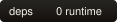
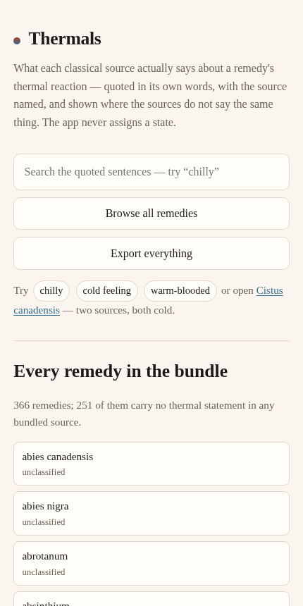

# Thermals

[](LICENSE)

<p>
  <a href="https://drsamonline.github.io/app-thermals/"></a>
  <a href="https://github.com/drsamonline/app-thermals/actions/workflows/test.yml"></a>
  <a href="https://github.com/drsamonline/app-thermals/actions/workflows/build-apps.yml"></a>
  <a href="LICENSE"></a>
  
  
</p>

**What each classical source actually says about a remedy's thermal reaction — in its own
words, with the source named — and where those sources do not say the same thing.**

**[Open the app →](https://drsamonline.github.io/app-thermals/play/)** ·
[Landing page](https://drsamonline.github.io/app-thermals/) ·
[The rule](#the-extraction-rule) ·
[Sources](#the-three-sources)

<!-- shot:start -->


<!-- shot:end -->

*The pipeline above keeps this screenshot of the live demo current. A curated set — desktop,
phone, landing page — lives in [`docs/assets/`](docs/assets) and is what the landing page uses.*

Light and dark, toggled from the header and remembered; the system preference decides the first
paint. Offline, no accounts, no server, no network at any point. One page, no build step, no runtime
dependencies — the four kits it uses are vendored.

## What it does

Look up a remedy and read what every bundled source says about its thermal reaction, each
statement quoted verbatim against the source that wrote it. Above the quotes sits a summary
**computed from those quotes**:

| Summary | When |
|---|---|
| `sources agree (n)` | two or more bundled sources speak, and all of them point the same way |
| `sources disagree` | two or more speak and they point opposite ways |
| `one source only` | exactly one bundled source speaks. **This is the common case and is never agreement** |
| `unclassified` | no bundled source carries a thermal statement for that remedy. It carries no quote and no summary |

A **dated note** is a temporary shift — an acute fever, a pregnancy, a proving — with an end
date. When the date passes the note stays visible, marked expired, and the constitutional
quotes are untouched.

| | |
|---|---|
| quoted sentences (rows) | **164** |
| remedies in the index | **366** |
| remedies with at least one statement | **115** |
| remedies with no statement in any source (`unclassified`) | **251** |
| sources | **3** |
| remedies carried by two sources | **12** |
| remedy names unresolved | **0** |
| quotes repaired from the page image | **6** |

<p align="center">
  
</p>

## What it must not do, and does not

- It never assigns, derives, averages or infers a thermal state. One row is one remedy, one
  source, one verbatim sentence.
- It never derives a classification from rubric counts or grades.
- It never selects or prescribes a remedy, and it does not decide anyone's thermal state.
- `ambithermal` is not a state this app looks for: no bundled source uses the word.
- A remedy no source speaks about is `unclassified` — no quote, no summary.

## The extraction rule

It ships with the data, because the row count is a property of it. A **thermal statement** is a
sentence in a source's own words containing one of these phrases, as whole words,
case-insensitively:

`chilly` · `chilliness` · `always cold` · `feels cold` · `feels hot` · `cold feeling` ·
`cold-blooded` · `warm-blooded` · `always warm` · `cold constitution` · `hot constitution` ·
`warm constitution` · `cold patient` · `hot patient`

1. **Modality lines and modality sections are excluded** — a modality is what changes a state,
   not what the state is.
2. **Fragments under 12 characters and paragraphs over 400 are excluded.** 12 and not 20
   because *"Chilly disposition."* — Jahr 1847, Cistus — is 19 characters and is exactly the
   statement this app exists to show.
3. **The sentence is kept verbatim.** Whitespace is normalised; nothing else is paraphrased,
   reordered, merged or trimmed.
4. The set is deliberately narrow: a bare *cold* or *heat* is not in it, because in this corpus
   those words are overwhelmingly water, air, a room, a modality or a fever.

`tools/extract.py` applies the rule; `tools/make-bundle.py` turns the result into the bundle the
page loads; `node test-node.js` checks the output.

## The three sources

| Source | Gives | Notes |
|---|---|---|
| **Open Materia Medica** — © Dr. Sohil Momin, BHMS, 2026 | 109 rows across 82 remedy pages | the estate's own plain-language materia medica, quoted with the copyright holder's permission |
| **Manual of Homoeopathic Medicine** — G. H. G. Jahr, trans. P. F. Curie, 1847 | materia medica text | public domain, via `homoeopathic-materia-medica-repertory-json` |
| **Homoeopathic Therapeutics of Diarrhoea** — James B. Bell, 7th ed., 1906 | materia medica text | public domain, checked against a [second scan of the same edition](https://archive.org/details/in.ernet.dli.2015.94901) |

`repertory/repertorium-publicum-2008/` in the JSON repository is GPL v3 and is **not** bundled.

## Correcting the names

The transcribed books are OCR. Some remedy names arrive damaged (`NTJX VOMICA`), some merged
with the next remedy, and some are really chapter headings. `tools/names.py` corrects what an
authority confirms and says so where none does.

**Authorities**, all free and named in `data/reference-names.json`: Open Materia Medica's 344
curated names, the repertory remedy index, and the Internet Archive's numbered index of Jahr's
*Manual* (1847).

| outcome | entries |
|---|---|
| confirmed — the printed name is already a known name | **79** |
| corrected from a named authority (26 of them readings the owner confirmed directly) | **47** |
| settled by a second scan of the same book, from the entry's own symptoms | **10** |
| readable, kept as printed (a remedy the reference does not carry) | **132** |
| **not bundled** — two remedies the transcription ran together | **27** |
| **not bundled** — not a remedy (chapter heading, page artefact, fragment, duplicate) | **7** |

Every correction carries its evidence in `data/name-overrides.json`, and the app shows the name
the transcription printed next to the correction, so a reader can check it rather than trust it.

## Repairing the texts

`text_damage` marks a quote that carries a swallowed page number, a broken word or a stray mark.
Where the damage can be repaired **from the page itself**, it is: `tools/text-repair.py` pulls
the scan's page-level OCR, finds the page carrying the sentence, and repairs only what the page
witnesses — `sen-` + `sitiveness` → `sensitiveness`, `alw'ays` → `always`, and a page number
swallowed into the prose. Six quotes are repaired this way, each keeping the transcription's own
words beside it and showing its page number.

**No quote currently carries a damage flag**, and the ones that were never damaged no longer say
they were.

## Run it

```bash
node test-node.js                      # 567 assertions
python3 -m http.server -d docs 8000    # landing page + app, or just open docs/index.html
```

Regenerating the data needs the two source repositories side by side:

```bash
python3 tools/names.py --fetch         # rebuild the name reference (needs archive.org)
python3 tools/names.py                 # apply it -> data/name-map.json
python3 tools/text-repair.py --fetch   # page-level OCR of the Bell scan
python3 tools/text-repair.py           # repair damaged quotes -> data/text-repairs.json
python3 tools/extract.py src/open-materia-medica src/materia-medica-json data
python3 tools/make-bundle.py
python3 tools/badges.py                # the local SVG badges
node test-node.js
```

## Layout

```
docs/index.html            the landing page (this project's own design)
docs/play/index.html       the app itself
docs/play/thermals.js      the logic the page and the tests both use
docs/play/data/bundle.js   the bundle: rows, remedies, the rule, the counts
docs/play/vendor/          web-kit, search-kit, case-kit, export-kit (vendored)
docs/assets/               screenshots and the generated badges
data/                      rows, remedies, name map, reference, text repairs
tools/                     extract, names, text-repair, make-bundle, badges
test-node.js               the suite
```

## Kits

**web-kit** (storage, and whether a write landed) · **search-kit** (ranked lookup across the
quoted sentences) · **case-kit** (the dated-override record) · **export-kit** (getting the bundle
and the notes off the device).

## Support


Free, offline, accountless — and staying that way. If it earned its keep:

| | |
|---|---|
| UPI (India) | `drsohilboi@ybl` — payee Dr. Sohil Momin, open amount, or scan [the QR](docs/assets/upi-qr.svg) |
| GitHub Sponsors | [github.com/sponsors/drsamonline](https://github.com/sponsors/drsamonline) |
| Ko-fi | [ko-fi.com/matneo](https://ko-fi.com/matneo) |
| PayPal | [paypal.me/drsohilmomin](https://paypal.me/drsohilmomin?locale.x=en_GB&country.x=IN) |
| My books | [Amazon author store](https://www.amazon.com/stores/author/B08ZT331LY/allbooks?ccs_id=aed72b9f-71d9-41dc-adee-e9368a317acc) |
| More apps | [drsamonline.github.io](https://drsamonline.github.io/) |
| Email | [sohilmomin2000@gmail.com](mailto:sohilmomin2000@gmail.com) |

Nothing is gated behind it: no accounts, no tracking, no network requests.

## Licence

PolyForm Noncommercial 1.0.0 — see `LICENSE`. The public-domain materia medica text inside stays
public domain.
