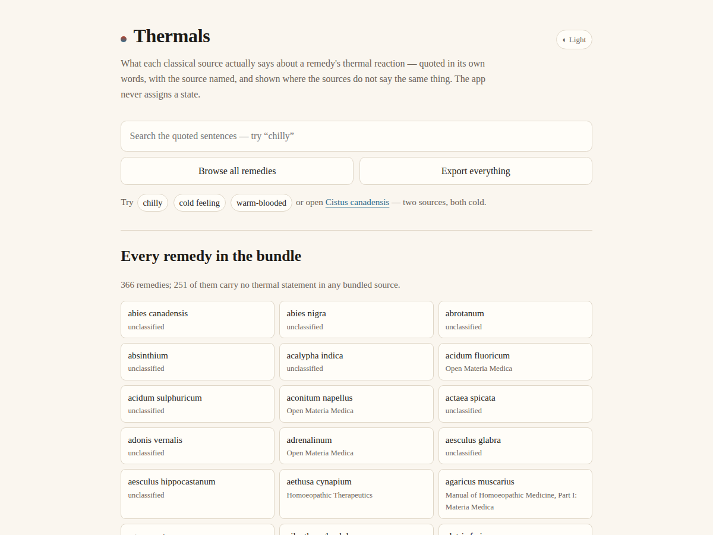

# Thermals

<!-- shot:start -->



<!-- shot:end -->

**What each classical source actually says about a remedy's thermal reaction — in its own words, with the source named — and where those sources do not say the same thing.**

Live: https://drsamonline.github.io/app-thermals/

Offline, no accounts, no server, no network at any point. One page, no build step, no dependencies beyond the estate's own kits.

## What it does

Look up a remedy and read what every bundled source says about its thermal reaction, each statement quoted verbatim against the source that wrote it. Above the quotes sits a summary **computed from those quotes**:

| Summary | When |
|---|---|
| `sources agree (n)` | two or more bundled sources speak, and all of them point the same way |
| `sources disagree` | two or more speak and they point opposite ways |
| `one source only` | exactly one bundled source speaks. **This is the common case and is never agreement** |
| `unclassified` | no bundled source carries a thermal statement for that remedy. It carries no quote and no summary |

A **dated note** is a temporary shift — an acute fever, a pregnancy, a proving — with an end date. When the date passes the note stays visible, marked expired, and the constitutional quotes are untouched.

## What it must not do, and does not

- It never assigns, derives, averages or infers a thermal state. One row is one remedy, one source, one verbatim sentence.
- It never derives a classification from rubric counts or grades.
- It never selects or prescribes a remedy, and it does not decide anyone's thermal state.
- `ambithermal` is not a state this app looks for: no bundled source uses the word (0 occurrences in the JSON books, 0 across the 344 Open Materia Medica pages).

## The extraction rule (it ships, because the row count is a property of it)

A **thermal statement** is a sentence in a source's own words containing one of these phrases, as whole words, case-insensitively:

`chilly` · `chilliness` · `always cold` · `feels cold` · `feels hot` · `cold feeling` · `cold-blooded` · `warm-blooded` · `always warm` · `cold constitution` · `hot constitution` · `warm constitution` · `cold patient` · `hot patient`

Then:

1. **Modality lines and modality sections are excluded.** A sentence under a heading containing "Modalit", or one that opens with "Worse" or "Better", is what changes a state, not what the state is.
2. **Fragments under 12 characters and paragraphs over 400 are excluded.** 12 and not 20 because *"Chilly disposition."* — Jahr 1847, Cistus canadensis — is 19 characters and is exactly the statement this app exists to show.
3. **The sentence is kept verbatim.** Whitespace is normalised; nothing else is paraphrased, reordered, merged or trimmed.
4. The set is deliberately narrow. A bare *cold* or *heat* is **not** in it: in this corpus those words are overwhelmingly about water, air, a room, a modality or a fever episode, and quoting them as the patient's thermal reaction would be the app putting a meaning into the source's mouth.

`tools/extract.py` applies the rule; `tools/make-bundle.py` turns the result into the bundle the page loads; `test-node.js` checks the rule's output.

## The data, measured (2026-11-01)

| | |
|---|---|
| quoted sentences (rows) | **164** |
| remedies in the index | **366** |
| remedies with at least one statement | **116** |
| remedies with no statement in any source (`unclassified`) | **250** |
| sources | **3** |
| remedies carried by two sources | **11** — Baryta carbonica, Carbolicum acidum, Cistus canadensis, Graphites, Kali carbonicum, Lycopodium clavatum, Nux vomica, Phosphorus, Sabadilla officinalis, Silicea terra, Sulphur |

Sources bundled:

- **Open Materia Medica** — 344 remedy pages, © Dr. Sohil Momin, BHMS, 2026. Quoted with permission of the copyright holder, who is the owner of this repository.
- **Manual of Homoeopathic Medicine, Part I: Materia Medica** — G. H. G. Jahr, trans. P. F. Curie, 1847 (public domain).
- **Homoeopathic Therapeutics** — James B. Bell, 1906 (public domain).

Both books come from `drsamonline/homoeopathic-materia-medica-repertory-json`, whose `repertory/repertorium-publicum-2008/` is GPL v3 and is **not** bundled.

### Honest limits, stated rather than papered over

- **There is no genuine disagreement in the bundle today.** Every two-source remedy points the same way (both say the patient is cold), so `sources disagree` is real machinery with nothing to fire on yet. It fires the day a third source lands that reads the other way. Nothing was invented to make the demo look better.
- **The books are OCR transcriptions and some of their remedy names are damaged** ("a8arum eiiropeijii", "ntjx vomica"). Those names are kept exactly as printed and do not join across sources — a name we cannot read is not a name we may correct. Book remedies enter the index only when they carry a statement.
- **No page numbers.** The JSON books carry no `page` field on any record and the Open Materia Medica pages are not paginated, so a row names its source and its chapter and never a page. A guessed page number is a fabricated citation.
- 250 of the 366 indexed remedies are `unclassified`. That is the honest answer for a corpus this size, not a gap to fill by inference.

## Correcting the names (added 2026-11-01)

The two transcribed books are OCR. Some of their remedy names arrive damaged
("NTJX VOMICA", "A8ARUM EIIROPEIJII"), some arrive merged with the next remedy
("Hepar Sulphuris. Haracleum Spondilium"), and some are really the book's own
chapter headings. Quoting a source under a name it never printed is a small lie, and
it stops the app joining two sources for the same remedy, so `tools/names.py` corrects
what can be proven and says so where it cannot.

**The authorities, all free and all named in `data/reference-names.json`:**

1. **Open Materia Medica** — the 344 remedy names curated in this estate (no OCR in them).
2. The **repertory remedy index** in the same JSON repository.
3. The **remedy index of Jahr's Manual of Homoeopathic Medicine (1847) as scanned by the
   Internet Archive** — [manualhomopathi01jahrgoog](https://archive.org/details/manualhomopathi01jahrgoog) —
   the same book, a second scan, with a numbered alphabetical index of every remedy.

**The rule, in order:** exact → merged (two known names run together) → the entry's own
abbreviation names one curated remedy → a curated name at ≥85% letter similarity *that
also sits in the right alphabetical slot* → otherwise **unresolved, kept exactly as
printed**. A readable name the reference simply does not carry is **not** an error and
is kept as printed; only visible OCR damage is ever corrected.

| outcome | entries |
|---|---|
| confirmed — the printed name is already a known name | **79** |
| corrected from a named authority (incl. 3 readings the owner supplied directly) | **24** |
| settled by a second scan of the same book, from the entry's own symptoms | **9** |
| readable, kept as printed (a remedy the reference does not carry) | **132** |
| unreadable, kept as printed and marked `spelling unconfirmed` in the app | **30** |
| **not bundled** — the transcription ran two remedies together | **27** |
| **not bundled** — not a remedy at all (a fragment of the book's own index) | **1** |

Every correction carries its evidence in `data/name-map.json`, and the app shows the name
the transcription printed next to the correction, so a reader can check it rather than
take it on trust. Two rules the tests enforce: a correction may never be justified by a
guess, and an entry the transcription merged with another remedy is **withheld** rather
than attributed to either.

### Reading the OCR, not guessing it

Matching is done on **the plausible readings of the damaged letters**, not on one
normalisation: a scan writes `8` for B in "A8ARUM" and for S elsewhere, `1` for L or I,
`4` for A, `€` for E, `£` for L. `tools/names.py` generates those readings and keeps the
best, using both a whole-string ratio and a partial ratio (the shorter spelling matched
inside the longer one), because an OCR adds and drops letters. A correction is accepted
only when the winner is **clear**: it must sit in the alphabetical slot between its named
neighbours and beat the runner-up by a margin. When two readings are nearly as close, the
name stays as printed — that is a decision the evidence did not make.

Three readings came from the owner directly and are recorded in `data/name-overrides.json`
rather than being silently applied: `SF.PIA` is **Sepia**, `KAT.l CARBONICUM` is **Kali
carbonicum**, `KAI4I BROMICUM` is **Kali bromatum**, and the archive.org index's own
`Sulphuris ad` is **Sulphuricum acidum** — that last one is the reference being repaired by
the same rule it applies to the entries.

### The second scan, and a correction I owe the reader

I wrote in 1.2.0 that no second scan of Bell existed, because the Internet Archive item
under that title and author is *Bell's therapeutics of diarrhoea*. **That was my mistake,
and it was backwards**: the JSON book transcribed here *is* the diarrhoea volume — its
chapters are "Before Stool", "During Stool", "After Stool", "Accompaniments". So the second
scan was on the shelf the whole time, at
[in.ernet.dli.2015.94901](https://archive.org/details/in.ernet.dli.2015.94901).

That changes the method for the worst names, and the method is now the strong one: the
heading does not have to be guessed, because **the entry's own symptom sentences can be
found in the second scan**, and the numbered remedy heading above them is the answer.
`tools/align-bell.py` does that, and `data/name-overrides.json` records each result with
the line number it came from. Nine entries were settled this way, among them:

| printed | settled as | why |
|---|---|---|
| `JETIICSA CYlTAPIITJtt` | **Aethusa cynapium** | "Drowsiness with chilliness" at line 910, inside section 4 `JETIIUSA CYMPItM` — not Jatropha, not Justicia |
| `FJ.ATERIIIM` | **Ferrum metallicum** | matched to section `FEBROf METAIXICUM` — `FJ.A` is the abbreviation *Fe. M.* |
| `N1U€£A` | **Silicea terra** | "Want of animal heat, always chilly, even when exercising" at line 8132, in the Silicea section between Sepia and Stannum |
| `BOliETUlS` | **Boletus laricis** | "Chilliness along the spine, followed by hot flashes and sweat" at line 2246 — Boletus *is* a remedy here and that is its own symptom |
| `XlNOIB£R` | *not a remedy* | its three "sentences" are fragments of the book's own repertory index — withheld, not named |

**Why this matters more than tidiness:** with the names settled, the two-source count went
**6 → 11** — Baryta carbonica, Graphites, Lycopodium, Sabadilla and Silicea now join their
Open Materia Medica entries, so the agreement machinery finally has data to work on.

## Run it

```bash
node test-node.js          # 78 assertions
python3 -m http.server -d docs 8000   # or just open docs/index.html
```

Regenerating the data needs the two source repositories next to each other:

```bash
python3 tools/names.py --fetch      # rebuild the name reference (needs archive.org)
python3 tools/names.py              # apply it -> data/name-map.json
python3 tools/extract.py src/open-materia-medica src/materia-medica-json data
python3 tools/make-bundle.py
node test-node.js
```

## Layout

```
docs/index.html            the app (one page, no build step)
docs/thermals.js           the logic the page and the tests both use
docs/data/bundle.js        the bundle: rows, remedies, the rule, the counts
docs/vendor/               web-kit, search-kit, case-kit, export-kit (vendored)
thermals.js, vendor/       the same two, at the root, for `node test-node.js`
data/rows.json             the extracted rows
data/remedies.json         the remedy index
tools/extract.py           the extraction rule
tools/names.py             the name-correction rule and its authorities
data/name-map.json         every correction, with the evidence for it
data/reference-names.json  the three authorities, with their URLs
tools/make-bundle.py       bundle builder
test-node.js               the suite
```

## Kits

- **web-kit** — storage, and whether a write actually landed
- **search-kit** — ranked lookup across the quoted sentences
- **case-kit** — the dated-override record shape
- **export-kit** — getting the bundle and the notes off the device

## Licence

PolyForm Noncommercial 1.0.0 — see `LICENSE`. The public-domain materia medica text inside stays public domain.
